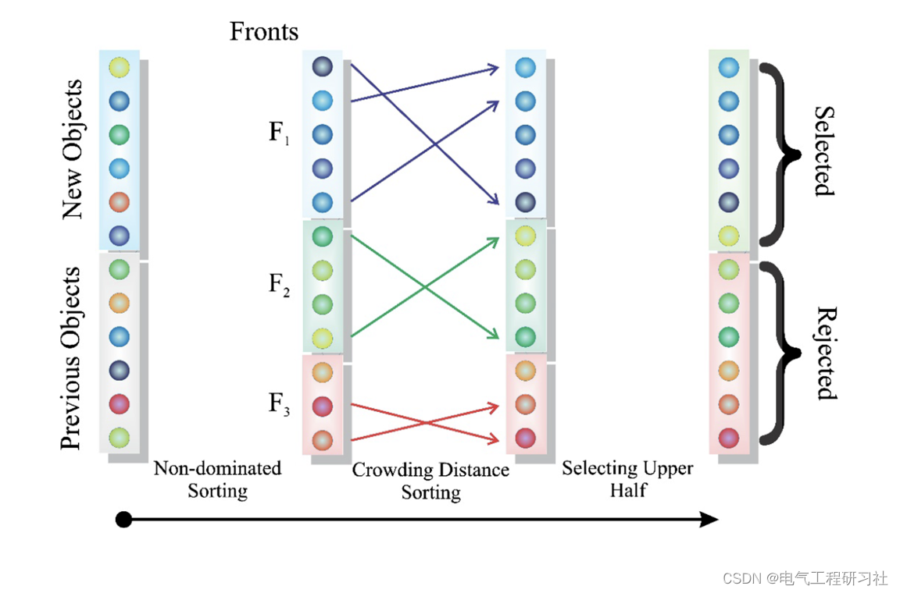
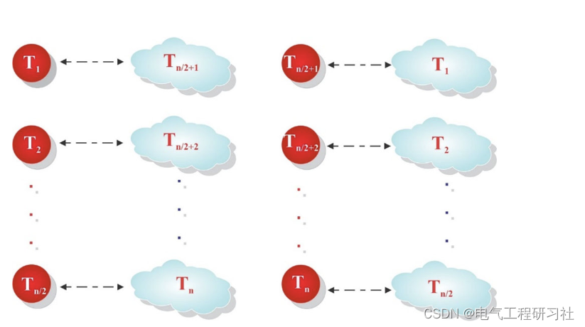
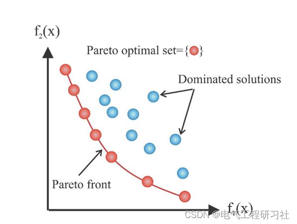
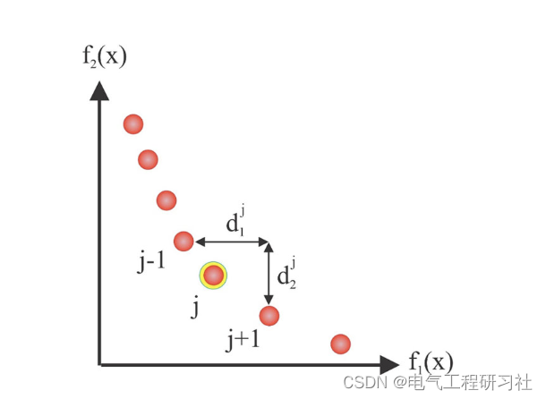
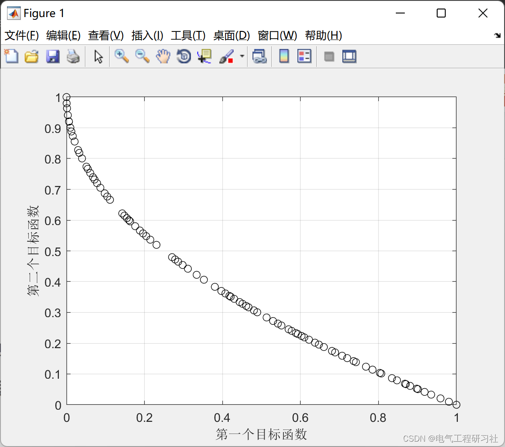
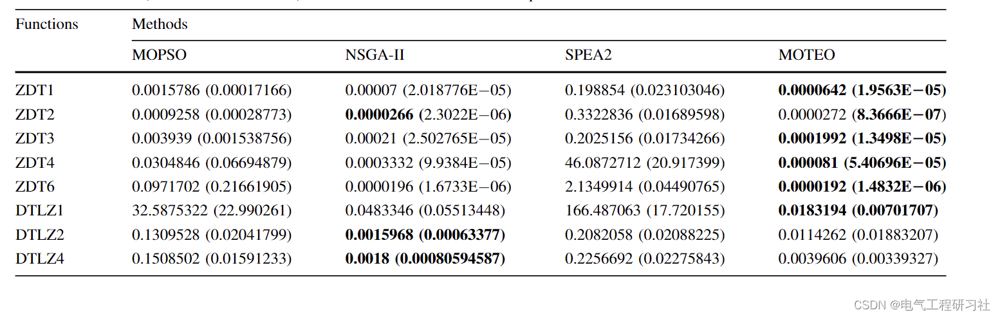
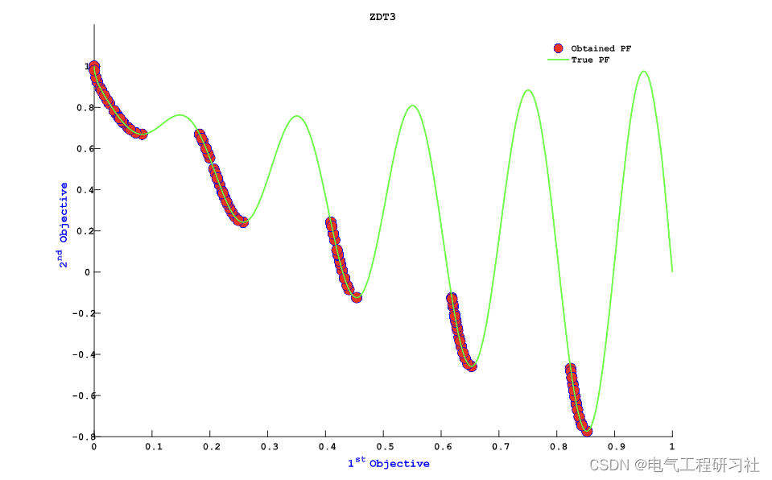

# [Optimization Algorithm] A Novel Multi-Objective Thermal Exchange MOTEO Optimization Algorithm for Engineering Problems (Matlab Code Implementation)

1 Overview
In structural design, engineers often encounter conflicting objectives that negatively impact each other. For example, on one hand, they aim to increase the strength of a structure to enhance safety, while on the other hand, for economic reasons, they may wish to reduce the weight of the structure. In mathematics, such problems involving two or more objectives are referred to as multi-objective optimization problems (MOP) (Talbi 2009). Typically, for MOP, there is no simple or straightforward answer. Their solutions are typically represented by a set of optimal solutions and are balanced between competing objectives, preventing improvements in these objectives without reducing some others. The Pareto Front provides designers with a set of solutions to choose from, allowing them to select one as the final design.
Editor
Abstract
In this paper, we propose a physical-inspired metaheuristic algorithm to solve multi-objective optimization problems. The algorithm is developed based on the concept of Newtonian cooling, which has recently been used effectively by the thermo-exchange optimization (TEO) algorithm for single-objective optimization problems. The performance of the TEO's multi-objective version (MOTEO) is checked through bi-objective and tri-objective mathematical and engineering problems, as well as a bi-objective structural design example. According to comparisons with several renowned algorithms, the proposed algorithm can provide high-quality Pareto fronts with appropriate precision, uniformity, and coverage for multi-objective problems.
Keywords: Thermo-exchange Optimization (TEO), Multi-objective Thermo-exchange Optimization (MOTEO), Algorithm, Truss structures, Mathematical problem
In this paper, the newly established multi-objective version of a physical-based algorithm, referred to as TEO (Kaveh and Dadras 2017), is introduced and applied to several structural examples with weighted and displacement objective functions. The algorithm has several advantages. It can be implemented in parallel to reduce processing time. Additionally, it does not require gradients of the objective function, which would necessitate complex and laborious computations in complex problems. However, it involves several internal parameters that can be adjusted, which can be time-consuming. Moreover, it does not guarantee global optimal solutions. Several mathematical benchmark functions are also examined to demonstrate its accuracy and quality compared to the true Pareto frontier. The results are compared with those of some well-known algorithms. The remainder of the paper is arranged as follows: Section 2 introduces the basic concepts of multi-objective optimization; Section 3 presents heat exchange optimization and its multi-objective version (MOTEO); Section 4 discusses the mathematical results and structural examples; the results analysis is presented in Section 1. Finally, Section 5 summarizes the entire paper.
Editor
2 Mathematical Models
Editor
For detailed mathematical models, refer to Part 4.
3. Running results - Edit
Editor
Editor
4. Read the Matlab code and article in detail. This article only showcases a part of the code, all codes can be found in:
Editor
​  

## Images

<!-- PAYMENT_BLOCK -->

## Get this dataset

- Payment link (Stripe): [Buy now](https://buy.stripe.com/3cs8yP7sY87d0vu9AB)
- Payment QR code: 

<!-- /PAYMENT_BLOCK -->
